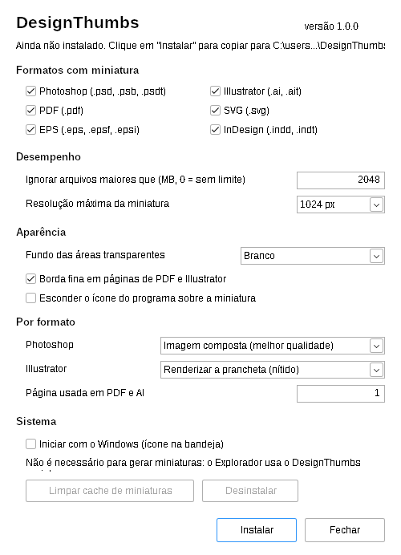

# DesignThumbs

**Miniaturas de arquivos de design no Explorador do Windows** — Photoshop, Illustrator, PDF, SVG, EPS e InDesign.
Gratuito, código aberto, sem precisar de administrador.

*[English below](#english)*

<p align="center"></p>

> **Status: beta.** Testado em Windows 11 x64. Se algum arquivo não gerar miniatura, [abra uma issue](../../issues) dizendo o formato e o programa/versão que salvou o arquivo.

## Formatos

| Formato | Extensões | Como a miniatura é gerada |
|---|---|---|
| Photoshop | `.psd` `.psb` `.psdt` | Imagem composta do arquivo (RGB, Tons de cinza, CMYK; 8/16 bits) — só as linhas necessárias são lidas, então PSDs enormes continuam rápidos. Outros modos usam a prévia embutida. |
| Illustrator | `.ai` `.ait` | Renderiza a prancheta via PDFium (exige "Criar arquivo compatível com PDF", que é o padrão). Sem isso, usa a miniatura XMP embutida. |
| PDF | `.pdf` | Renderiza a página escolhida (padrão: 1ª) via PDFium. |
| SVG | `.svg` | Renderizado com lunasvg. `.svgz` ainda não é suportado. |
| EPS | `.eps` `.epsf` `.epsi` | Prévia TIFF/WMF do cabeçalho; senão, miniatura XMP (EPS do Illustrator). |
| InDesign | `.indd` `.indt` | Miniatura XMP salva pelo InDesign. |

## Instalar

1. Baixe o `.zip` da [última versão](../../releases/latest).
2. **Antes de extrair:** botão direito no zip > **Propriedades** > marque **Desbloquear** > OK. (Evita o aviso "O Windows protegeu o computador", porque o programa ainda não tem assinatura digital.)
3. Extraia, abra `DesignThumbs.exe` e clique em **Instalar**.
4. Aceite limpar o cache de miniaturas.

Instala por usuário em `%LOCALAPPDATA%\Programs\DesignThumbs` (não precisa de administrador). Se você usa SageThumbs ou outro gerador de miniaturas para os mesmos formatos, desinstale antes.

**Desinstalar:** Configurações > Aplicativos > DesignThumbs, ou o botão "Desinstalar" no próprio app.

## Opções

- Ativar/desativar cada formato
- Ignorar arquivos acima de X MB
- Resolução máxima da miniatura (256 a 2048 px)
- Fundo de áreas transparentes: branco, transparente ou xadrez
- Borda fina em páginas de PDF/AI
- Esconder o ícone do programa sobre a miniatura
- Photoshop: imagem composta (qualidade) ou prévia embutida (rapidez)
- Illustrator: renderizar prancheta ou usar miniatura embutida
- Página usada em PDF/AI
- Iniciar com o Windows (ícone na bandeja — opcional; as miniaturas funcionam sem isso)

## Limitações conhecidas

- **Arquivos só na nuvem** (Google Drive em streaming, OneDrive "somente online") não recebem miniatura até serem baixados — o Windows não chama geradores de miniatura para eles.
- PSD em Lab, Duotone, Indexado, Multicanal ou 32 bits usa a prévia embutida (menor).
- PSD salvo com "Maximizar compatibilidade" desligado usa a prévia embutida.
- EPS sem prévia e `.svgz` não geram miniatura.

## Como funciona

`DesignThumbs.dll` é um *thumbnail provider* COM (`IThumbnailProvider` + `IInitializeWithStream`) registrado em `HKCU\Software\Classes`. O Explorador o carrega isolado em `dllhost.exe`: se um arquivo der erro, a miniatura simplesmente não aparece — o Explorador não fecha. O app `DesignThumbs.exe` só instala, registra e salva as opções em `HKCU\Software\DesignThumbs`.

## Compilar

Em Linux (ou WSL), com mingw-w64:

```bash
sudo apt install mingw-w64 git curl zip
bash scripts/build.sh
# resultado: dist/DesignThumbs-<versão>.zip
```

O script baixa o [lunasvg](https://github.com/sammycage/lunasvg) e os binários do [PDFium](https://github.com/bblanchon/pdfium-binaries) nas versões fixadas. O GitHub Actions compila cada commit e publica uma release automaticamente quando a versão em `src/common.h` muda.

`build/render.exe <px> <pasta_saida> arquivos...` gera PNGs das miniaturas sem passar pelo Explorador (útil para testar).

## Licença

[MIT](LICENSE). Componentes de terceiros: veja [THIRD_PARTY_NOTICES.md](THIRD_PARTY_NOTICES.md).
Photoshop, Illustrator e InDesign são marcas da Adobe. Este projeto não tem ligação com a Adobe.

---

## English

**DesignThumbs** adds File Explorer thumbnails for Photoshop (`.psd/.psb`), Illustrator (`.ai`), PDF, SVG, EPS and InDesign (`.indd`) files on Windows 10/11 x64. Free, open source, per-user install (no admin rights).

- **Install:** download the zip from [Releases](../../releases/latest), right-click > Properties > **Unblock**, extract, run `DesignThumbs.exe` and click **Instalar** (Install). The UI is in Portuguese.
- **How it works:** a COM thumbnail provider registered under `HKCU`, running in Explorer's isolated surrogate process. PSD composites are sampled row by row (fast on huge files); PDF/AI are rendered with PDFium; SVG with lunasvg; EPS/INDD use embedded previews.
- **Limitations:** cloud-only files (OneDrive/Google Drive placeholders) get no thumbnails until downloaded; `.ai` needs "Create PDF Compatible File" for a sharp render.
- **Build:** `bash scripts/build.sh` on Linux with mingw-w64.
- **Status:** beta — bug reports welcome.

License: MIT. Not affiliated with Adobe.
